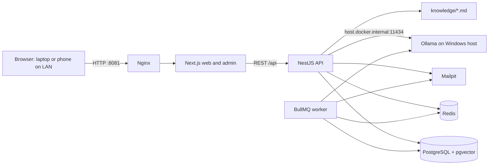

# Architecture

## System overview



## Services and responsibilities

| Service    | Responsibility                                                                                                 |
| ---------- | -------------------------------------------------------------------------------------------------------------- |
| Nginx      | Single LAN-facing entry point; publishes configurable host port `8081` by default and routes web/API requests. |
| Web        | Next.js App Router storefront, customer account pages, and role-protected `/admin` UI.                         |
| API        | NestJS REST API, validation, authentication, business rules, Swagger/OpenAPI, and request-ID logging.          |
| Worker     | BullMQ jobs for simulated order progression, fake email, and product/document re-indexing.                     |
| PostgreSQL | Relational application data, Vietnamese search extensions, and 1024-dimensional vector embeddings.             |
| Redis      | Queue backend, cache, rate-limit state, and short-lived session/cart data.                                     |
| Mailpit    | Local-only fake mailbox; no real email is sent.                                                                |
| Ollama     | Optional local LLM and embedding provider running on the Windows host, not in Docker.                          |

Services should use health checks and healthy-start ordering. Persistent data uses named volumes. Containers should run as non-root where supported and have conservative memory limits. Only Nginx is exposed to the LAN; Mailpit's UI is bound to localhost, and API/database/Redis ports are not published.

## Network and access

- On the laptop, open `http://localhost:8081` by default.
- For a phone on the same private Wi-Fi, open `http://<laptop-LAN-IP>:8081`; allow the web port through Windows Firewall only on the Private network profile.
- Containers reach host Ollama at `http://host.docker.internal:11434`.
- If that connection fails on Windows, set `OLLAMA_HOST=0.0.0.0` for the host Ollama service and add a narrowly scoped Windows Firewall rule for the private network. The API should report an actionable, non-fatal health warning if Ollama is unavailable.
- HTTPS is required by browsers for PWA installation on LAN; plain HTTP remains suitable for local development and ordinary browsing.

## Main data flows

1. A browser requests the storefront through Nginx. Next.js renders the page and calls the REST API for catalog or account data.
2. The catalog API validates filters and pagination, queries PostgreSQL for product data, and combines `unaccent` with `pg_trgm` for Vietnamese diacritic-insensitive and typo-tolerant search.
3. The API validates input, applies business rules, reads/writes PostgreSQL, and uses Redis for ephemeral state, caching, rate limits, and queues.
4. Checkout stores order/payment state in PostgreSQL. Jobs are queued in Redis; workers update simulated statuses and deliver fake messages to Mailpit.
5. Product and policy content is indexed from the database and `knowledge/`. The chatbot retrieves local sources only; it has no web access.

## Chatbot retrieval flow

```mermaid
flowchart LR
  Docs[knowledge/*.md] --> Chunk[Chunk and attach source metadata]
  Products[Product data in PostgreSQL] --> Chunk
  Chunk --> Embed[Ollama bge-m3 or configured provider]
  Embed --> Vectors[(pgvector vector(1024))]
  Question[Customer question] --> Search[Hybrid vector + keyword/trigram retrieval]
  Search --> Threshold{Relevant local sources?}
  Vectors --> Search
  Search -->|Yes| Context[Retrieved passages with source IDs]
  Context --> LLM[Configured LLM provider]
  LLM --> Reply[Vietnamese response with grounded facts]
  Threshold -->|No| Unknown[Say it does not know; offer simulated support ticket]
```

Retrieved text is untrusted data, not instructions. Live product, stock, price, voucher, shipping, and authorized order facts must come from deterministic API lookups rather than model memory. The chatbot is deliberately scheduled after the storefront and core commerce features.

## Suggested local resource budget

The laptop has 16 GB RAM. Keep the WSL2 VM around 6 GB as an initial ceiling and leave memory for Windows, the browser, and host Ollama. Example Docker memory targets (adjust after measuring actual use):

| Container group                 |  Initial budget |
| ------------------------------- | --------------: |
| PostgreSQL                      |          1.5 GB |
| Web                             |          512 MB |
| API                             |          768 MB |
| Worker                          |          512 MB |
| Redis                           |          256 MB |
| Nginx + Mailpit                 | 256 MB combined |
| **Approximate container total** |      **3.8 GB** |

These are starting limits, not performance guarantees. Avoid running multiple model workloads concurrently; Ollama model memory is outside the Docker container budget. Monitor Docker Desktop and host memory before raising limits.
