# Data model

The diagram captures the intended domain. Exact columns and constraints are finalized alongside each implementation phase. Monetary amounts are integer VND, never floating point.

```mermaid
erDiagram
  USER ||--o{ ADDRESS : has
  USER ||--o{ ORDER : places
  USER ||--o{ REVIEW : writes
  USER ||--o{ WISHLIST_ITEM : saves
  USER ||--o{ LOYALTY_TRANSACTION : earns
  USER ||--o{ VOUCHER_REDEMPTION : redeems
  USER ||--o{ AUDIT_LOG : performs
  USER ||--o{ CHAT_SESSION : starts
  USER ||--o{ CART : owns
  CATEGORY ||--o{ PRODUCT : groups
  BRAND ||--o{ PRODUCT : makes
  SERIES ||--o{ PRODUCT : features
  PRODUCT ||--o{ PRODUCT_VARIANT : offers
  PRODUCT ||--o{ PRODUCT_IMAGE : displays
  PRODUCT ||--o{ REVIEW : receives
  PRODUCT ||--o{ WISHLIST_ITEM : saved_as
  PRODUCT ||--o{ CART_ITEM : contained_in
  PRODUCT ||--o{ ORDER_ITEM : purchased_as
  PRODUCT_VARIANT ||--o{ STOCK_MOVEMENT : tracks
  PRODUCT_VARIANT ||--o{ CART_ITEM : selected_as
  PRODUCT_VARIANT ||--o{ ORDER_ITEM : selected_as
  CART ||--o{ CART_ITEM : contains
  ORDER ||--|{ ORDER_ITEM : contains
  ORDER ||--o{ ORDER_STATUS_HISTORY : records
  ORDER ||--o{ PAYMENT : paid_by
  ORDER ||--o{ VOUCHER_REDEMPTION : applies
  VOUCHER ||--o{ VOUCHER_REDEMPTION : used_in
  CHAT_SESSION ||--o{ CHAT_MESSAGE : contains
  CHAT_MESSAGE ||--o{ CHAT_FEEDBACK : receives
  KNOWLEDGE_DOCUMENT ||--o{ KNOWLEDGE_CHUNK : splits_into
  BANNER }o--o| PRODUCT : optionally_links

  USER {
    uuid id PK
    string email UK
    string password_hash
    string role
    datetime email_verified_at
    datetime created_at
  }
  ADDRESS {
    uuid id PK
    uuid user_id FK
    string recipient_name
    string phone
    string province_code
    string district_code
    string ward_code
    string address_line
    boolean is_default
  }
  CATEGORY {
    uuid id PK
    string name
    string slug UK
    uuid parent_id FK
  }
  BRAND {
    uuid id PK
    string name
    string slug UK
  }
  SERIES {
    uuid id PK
    string name
    string slug UK
  }
  PRODUCT {
    uuid id PK
    uuid category_id FK
    uuid brand_id FK
    uuid series_id FK
    string name
    string slug UK
    string figure_type
    string scale
    string material
    date release_date
    int price_vnd
    int sale_price_vnd
    boolean is_preorder
    int preorder_deposit_vnd
    string status
    string description
  }
  PRODUCT_VARIANT {
    uuid id PK
    uuid product_id FK
    string sku UK
    string name
    int stock_on_hand
    int stock_reserved
  }
  PRODUCT_IMAGE {
    uuid id PK
    uuid product_id FK
    string path
    string alt_text
    int sort_order
    boolean is_placeholder
  }
  STOCK_MOVEMENT {
    uuid id PK
    uuid variant_id FK
    int quantity_delta
    string reason
    uuid actor_id FK
    datetime created_at
  }
  CART {
    uuid id PK
    uuid user_id FK
    string guest_token
    datetime expires_at
  }
  CART_ITEM {
    uuid id PK
    uuid cart_id FK
    uuid product_id FK
    uuid variant_id FK
    int quantity
    int price_snapshot_vnd
  }
  ORDER {
    uuid id PK
    uuid user_id FK
    string order_number UK
    string status
    int subtotal_vnd
    int shipping_fee_vnd
    int discount_vnd
    int total_vnd
    string shipping_address_snapshot
    datetime created_at
  }
  ORDER_ITEM {
    uuid id PK
    uuid order_id FK
    uuid product_id FK
    uuid variant_id FK
    string product_name_snapshot
    int unit_price_vnd
    int quantity
  }
  ORDER_STATUS_HISTORY {
    uuid id PK
    uuid order_id FK
    string from_status
    string to_status
    string note
    datetime created_at
  }
  PAYMENT {
    uuid id PK
    uuid order_id FK
    string method
    string status
    int amount_vnd
    string idempotency_key UK
    datetime expires_at
  }
  VOUCHER {
    uuid id PK
    string code UK
    string kind
    int value
    int minimum_order_vnd
    datetime starts_at
    datetime expires_at
    int global_limit
    boolean is_stackable
  }
  VOUCHER_REDEMPTION {
    uuid id PK
    uuid voucher_id FK
    uuid user_id FK
    uuid order_id FK
    int discount_vnd
    datetime redeemed_at
  }
  LOYALTY_TRANSACTION {
    uuid id PK
    uuid user_id FK
    uuid order_id FK
    int points_delta
    string reason
    datetime created_at
  }
  REVIEW {
    uuid id PK
    uuid user_id FK
    uuid product_id FK
    uuid order_item_id FK
    int rating
    string body
    string moderation_status
    datetime created_at
  }
  WISHLIST_ITEM {
    uuid id PK
    uuid user_id FK
    uuid product_id FK
    datetime created_at
  }
  BANNER {
    uuid id PK
    string title
    string image_path
    string target_url
    uuid product_id FK
    boolean is_active
  }
  AUDIT_LOG {
    uuid id PK
    uuid actor_id FK
    string action
    string entity_type
    uuid entity_id
    string request_id
    datetime created_at
  }
  CHAT_SESSION {
    uuid id PK
    uuid user_id FK
    string guest_token
    datetime created_at
  }
  CHAT_MESSAGE {
    uuid id PK
    uuid session_id FK
    string role
    string content
    string source_ids
    datetime created_at
  }
  CHAT_FEEDBACK {
    uuid id PK
    uuid message_id FK
    string rating
    string comment
    datetime created_at
  }
  KNOWLEDGE_DOCUMENT {
    uuid id PK
    string source_path UK
    string title
    string checksum
    datetime indexed_at
  }
  KNOWLEDGE_CHUNK {
    uuid id PK
    uuid document_id FK
    int chunk_index
    string content
    string metadata
    vector embedding
  }
```

`KNOWLEDGE_CHUNK.embedding` is PostgreSQL `vector(1024)`. Prisma does not have a native pgvector scalar type: represent it with `Unsupported("vector(1024)")`, and use parameterized raw SQL for vector inserts and similarity queries. Product search combines `unaccent` and `pg_trgm`; migrations enable required extensions. The order's shipping address is an immutable snapshot, rather than a live relation to an editable address-book entry.

The current Vietnam province/district/ward dataset and its administrative structure must be checked during implementation and recorded in `DECISIONS.md`; the application must bundle static data for offline use.
